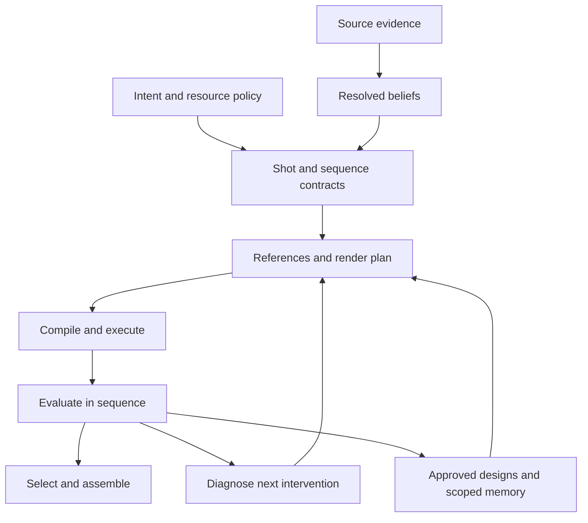

# Fire & Ice — Local Reconstruction System v0.3

**Revised:** 2026-09-16. **Status:** authoritative project intent and system design; implementation remains to be built and measured. This replaces the conversational brainstorming as the operational plan. The five supplied documents are preserved byte-for-byte in `research_archive/` in the complete package.

## 1. The system we are building

Create a coherent, painterly AI version of *Fire and Ice*, generated locally on one Ubuntu workstation with one RTX 5090 and 64 GB system RAM. Use the user's existing film as the source master. Preserve its story, identities, meaningful action, and original audio/edit timing while allowing stronger composition, richer detail, and different staging where they improve the result.

The central product is an **editable, evidence-backed film model**. Generated clips are candidate realizations of that model. The agent's job is to reduce the most consequential uncertainty or defect, choose a useful action within budget, observe what happened, and leave a better project state for the next session.

The optimization target is **accepted, coherent screen seconds per total production effort**. Count GPU occupancy, model loading, reference preparation, human review, repair, and discarded output. A faster individual inference can still make the project slower if it produces more unusable footage.

## 2. Decisions carried forward from the user's brainstorming

| Decision | Operational consequence |
| --- | --- |
| Local generation on the specified machine | Local inference is the production path. Hosted H3, Context-IR, lip sync, and regeneration are optional future adapters, disabled by default. |
| No model training | Use existing compatible image models, edit models, and LoRAs. Curation and retrieval improve over time; weights do not train themselves. |
| Main characters curated manually | The user establishes target character designs. Agents propose and prepare assets and automate consistent derivatives. |
| Reusable locations matter | Build approved location reference sets alongside characters; avoid restyling every boundary frame. |
| Cull before multi-rolling | One probe first; diagnose before a second render. No automatic nine-take matrix. |
| A shot may differ if it is better | Preserve explicitly contracted story/timing/identity constraints. Source pose, lens, layout, and camera are observations, not universal obligations. |
| Use original movie audio | Preserve the selected source audio stream as the continuous editorial authority. Separated stems and exact lip sync are optional, separately verified capabilities. |
| Ref2V is the practical default | Start with a minimal Ref2VA reference set. Endpoint guides, FL2VA, and V2V are targeted alternatives when a named failure justifies them. |

These preferences override conflicting assistant proposals in the historical conversation. In particular, the project does not require a cloud cluster, a different film edition, a photoreal style, training a Frazetta LoRA, or generating FFLF assets for every shot.

## 3. A tower of linked abstractions

Each layer answers one question and refers to the exact revisions below it. Moving upward compresses evidence into decisions; moving downward explains a result.

| Layer | Durable representation | Agent question |
| --- | --- | --- |
| Intent | ProjectPolicy + StyleBible | What does better mean, and what resources may I spend? |
| Film world | SourceMaster + SequenceContract + identity/location/design revisions | What story and continuity must this part of the film maintain? |
| Shot understanding | Evidence + Observation + resolved Assertion view | What is visible/audible, how do we know, and what is unresolved? |
| Target | ShotContract | What must this output achieve, and where is creative freedom allowed? |
| Intervention | ReferenceSelection + RenderPlan | Which controllable inputs should realize that target? |
| Execution | CompiledRequest + Attempt + artifact manifest | What exactly ran, against which bytes, and what did it cost? |
| Judgment | Evaluation + Selection + AssemblyManifest | Does the candidate work in the film, and which realization is chosen? |
| Learning | Outcome + scoped Recipe | What should a comparable future decision do differently? |

The shared definitions, ownership, time rules, and command behavior live in [SYSTEM_CONTRACT.md](SYSTEM_CONTRACT.md). The other specifications refine their layer; they do not redefine these objects.

The feedback arrow to memory stores evidence and candidate lessons. It does not automatically promote every successful render into a universal rule.

## 4. What the agent needs at the controls

At session start, `fi project.resume` should return a compact project packet: goal, active policy/style revisions, source master, selected sequence, accepted coverage, budget remaining, worker status, unresolved submissions, blockers, and the highest-value next actions. It includes the last consequential decisions and changes since the agent's cursor.

For a shot, `fi shot.context` returns a bounded **ShotContextPacket** with:

- the target and its hard, soft, and free dimensions;
- a small, exact-PTS contact sheet, source clip, and local audio interval;
- relevant characters, appearance states, location, and approved target designs;
- immediate continuity requirements and dialogue context, including offscreen speech;
- evidence-backed unknowns, alternatives, and a clear distinction between missing evidence and contradictory evidence;
- selected references and short explanations of their roles;
- the best attempt, evaluation reasons, attempt ancestry, and what changed last;
- executable next actions, expected information or quality gain, estimated resource ranges, and stop conditions.

Default packets contain at most 8 evidence thumbnails, 5 reference candidates per requested role, and a 4,000-token text budget. These are tunable design limits, not model specifications. Return omitted counts and handles for expansion. Never truncate a hard constraint to meet the limit; return an overflow warning and a separate constraints object.

The UI and agent use the same command handlers. Human review shows the original, candidate, selected references, specific failed constraints, and neighboring shots. Its default is one candidate or a pairwise comparison. A nine-cell grid is not the normal workflow.

## 5. Separate truth, target, control, and result

Four distinctions prevent most expensive mistakes:

1. **Source truth versus target design.** Film frames establish what the original contains. An approved richer Teegra design establishes what the new film should render. Neither silently overwrites the other.
2. **Belief versus requirement.** A suspected pan is an observation with uncertainty. A required left-to-right exit is a contract decision. A render may reinterpret a pan while satisfying that exit.
3. **Requirement versus capability.** Requesting lip sync, an exact endpoint, or a prop handoff does not prove the current renderer can deliver it. The adapter declares support; tests establish measured reliability.
4. **Capability versus quality.** A valid request and a decodable clip do not prove artistic or semantic success. Evaluation refers back to the contract and sequence context.

When constraints conflict, the planner returns the smallest conflicting set with alternatives. It does not silently relax an identity, audio, or story lock to make a request compile.

## 6. Local architecture and resource discipline

Build a modular Python application, a local review surface, and a ComfyUI execution adapter. Start with a single authoritative SQLite database and immutable content-addressed files on the workstation. ReferenceMemory and IdentityGraph are logical modules over these records, not separate services or graph databases. DuckDB, Parquet, and vector indexes are optional rebuildable read views.

CPU work may overlap within RAM and I/O limits. Heavy VLM, image generation, H3 encoding/rendering, embeddings, and GPU evaluation share one exclusive GPU lease. Finish bounded batches, save results, unload, confirm resource release, then switch roles. Favor a sequence-sized working set to balance model-loading cost against early feedback.

The RTX 5090 has 32 GB VRAM; system RAM is a separate budget. H3's official architecture includes a large dedicated encoder and generator. That makes quantized artifacts, staged residency, and host-memory peaks first-class engineering concerns. No throughput or memory-fit claim for this exact machine has been measured here. [NVIDIA specifications](https://www.nvidia.com/en-us/geforce/graphics-cards/50-series/rtx-5090/), [H3 architecture](https://github.com/MiniMax-AI/MiniMax-H3)

The first gate is therefore a complete local probe: load, encode real references, denoise, decode, write, unload, and repeat. Include the maximum reference shape intended for the pilot. An empty GPU before startup is not proof that the workload fits. See [H3 render strategy](H3_Render_Strategy_v0_3_agent_native.md).

## 7. The production loop

1. **Ingest the master once.** Hash source bytes; inspect streams, PTS, aspect/color metadata, and audio layout. Detect cuts as proposals and correct obvious false boundaries. Extract proxies and evidence on demand.
2. **Understand a small sequence.** Align available text to this master, perform a cheap visual pass, and resolve only uncertainties that could change the next decision.
3. **Approve reusable designs.** Curate needed lead characters and the location before extending the corpus. Generate extras only when needed, with persistent identities within the sequence.
4. **Commit shot targets.** Define essential action, story outcome, timing, identity, and continuity. Mark composition/camera freedoms explicitly.
5. **Select controls and run one probe.** Compile a minimal Ref2VA request with pinned assets, timing, workflow, and execution profile.
6. **Evaluate and intervene.** Run file/timing checks first, targeted perceptual checks second, and human visual judgment where it adds value. Repair a named cause, or stop when the candidate is good enough.
7. **Select in context.** Watch adjacent shots with original audio. Check transitions, eyelines, props, color, action order, and visible speech. Accept the selected candidate without mandatory rerendering at another profile.
8. **Assemble and preserve learning.** Produce exact timeline placements, a continuous audio track, reproducible manifests, and a compact comparison/outcome record. Revisit only dependencies affected by later corrections.

## 8. Time and original audio are part of the model

Keep four coordinate systems explicit: source PTS, editorial time, generated frame index, and audio sample index. A `TimeMap` connects them. Never infer these mappings from filenames or rounded seconds.

The original audio continues across shot boundaries, including music, narration, and cross-cut speech. A soundtrack mux does not create lip sync. A generated mouth-moving shot is not validated by the presence of the correct audio track. Visible dialogue must be assessed separately; failures can be repaired locally, restaged within the contract, or left explicitly unresolved.

Preserve the original visual aspect ratio and color interpretation as the default editorial canvas. Stylization may intentionally change the look through the StyleBible. Do not accidentally stretch a 1.85:1 master to 16:9 or compare HDR and SDR pixels without a recorded display transform.

## 9. Accretion means improving decisions, not accumulating logs

Every useful outcome should improve at least one reusable object: an identity assertion, design reference, reference ranking, cost estimate, failure diagnosis, compiler fixture, or scoped recipe. A rejected clip can be valuable if it rules out a strategy cheaply.

Store the alternatives considered, why one was chosen, what changed, what was measured, and how applicable the result is elsewhere. Keep unsuccessful and inconclusive attempts. Distinguish a controlled comparison from an association; selecting a good clip does not establish which reference caused it.

Promotion follows **observation → candidate lesson → comparison on different shots → versioned recipe → monitored use**. Keep a rollback pointer. Human preferences are data for policy calibration, not automatic weight updates or permission to rewrite agent instructions.

## 10. Delivery path and completion

The first milestone is one shot through the full loop, then a contiguous three-to-five-shot sequence with original audio and shared identities. This is a vertical slice of the eventual film, not a separate architecture. The explicit build steps and acceptance gates are in [IMPLEMENTATION_PLAN.md](IMPLEMENTATION_PLAN.md).

Then expand to six representative shots, promote only useful strategy alternatives, process sequences in bounded batches, and finally assemble the complete master. Full-film completion requires coverage of every intended editorial interval, verified audio/timing, reviewed continuity, traceable selected takes, and a restorable project snapshot. Source placeholders may appear only in a clearly labeled work print.

**Out of scope for the first slice:** model training, broad crawling, autonomous global style changes, mandatory FL2VA/V2V, distributed infrastructure, automatic 2K/4K polish, and exhaustive benchmarks.

## 11. How the documents fit together

| Document | Owns |
| --- | --- |
| This document | Intent, creative policy, end-to-end operating model |
| [SYSTEM_CONTRACT.md](SYSTEM_CONTRACT.md) | Vocabulary, records, clocks, revisions, commands, budgets, invalidation, recovery |
| [H3_Render_Strategy_v0_3_agent_native.md](H3_Render_Strategy_v0_3_agent_native.md) | Hardware gates, renderer capabilities, profiles, experiments, repair and timing realization |
| [VLM_H3_Prompting_v0_3_agent_native.md](VLM_H3_Prompting_v0_3_agent_native.md) | Perception, uncertainty, semantic planning, deterministic compilation |
| [Fire_and_Ice_Character_Timeline_v0_3_agent_native.md](Fire_and_Ice_Character_Timeline_v0_3_agent_native.md) | Source identity, dialogue alignment, target designs, appearances and continuity |
| [Frazetta_Corpus_Scraper_Ingestion_Spec_v0_3_agent_native.md](Frazetta_Corpus_Scraper_Ingestion_Spec_v0_3_agent_native.md) | Acquisition, provenance, dedupe, role-aware retrieval and usage evidence |
| [IMPLEMENTATION_PLAN.md](IMPLEMENTATION_PLAN.md) | Build order, proof obligations, milestones, feature-scale expansion |
| [CHANGE_RECORD.md](CHANGE_RECORD.md) | Superseded assumptions, corrections, migration and remaining unknowns |

The research archive retains source leads and historical arguments. It is evidence for inspection, not active runtime instructions.
