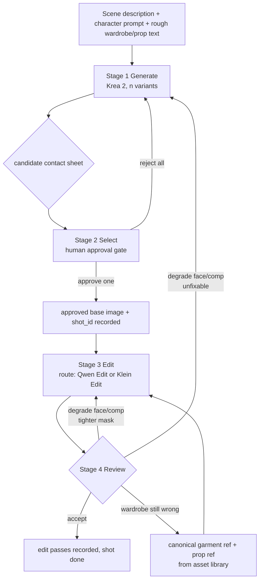

# Krea → Edit-Model Shot Pipeline (spec)

Date: 2026-10-15
Status: spec (design authority for the "movie-like character appearance consistency" workstream)
Companion docs: asset schema (task 0, `t_f43db451`), prompt/param templates (task 2, `t_cddb1c9c`).

## 1. Purpose and the gap it closes

Krea 2 generates the shot, but its wardrobe/prop detail **drifts even at fixed seed +
prompt + LoRA** (the Teegra bikini-top case: keyhole halter in one run, gathered-V seam in
the next). The fix is a two-hop approach: generate freely with Krea 2, get a human to approve
the *composition/pose/lighting/likeness*, then hand the approved base image + the **canonical**
wardrobe/prop reference to an edit model to swap in the correct garment/prop.

Two models on the table:

- **Qwen-Image-Edit-2509** (Lightning 8-step). Files present on the 5090
  (`qwen/misc/Qwen-Image-Edit-2509-Lightning-8steps-V1.0-{bf16,fp32}.safetensors`, needs a
  Qwen2.5-VL-7B text encoder loaded separately via `CLIPLoader(type=qwen_image)` + the Qwen
  Image VAE; the **5090 is the edit box** — the pilot confirmed the checkpoint + VAE + edit
  nodes all live there, and only the text encoder is missing). Shares the **same VAE as Krea
  2**, so latents can be handed between them. Re-synthesizes the whole frame: unedited regions
  drift and faces can shift identity across an edit chain.
- **Klein Edit** — the user's term, concretely **Flux2Klein** (pilot, task t_fe6d39e6).
  Its ComfyUI nodes are present on the 5090 as auto-download stubs, but the checkpoint itself
  is not confirmed downloaded on either box. §7 routes on it conditionally and flags the
  download as an open item.

The unit of work is the **shot**, but the pipeline is camera/chronology-agnostic: it runs
per-shot against the asset library, exactly like the existing setup-driven render pipeline.

## 2. Flow diagram



Text form:

```
scene_desc + char_prompt + rough_wardrobe  ──►  [1] Krea2 generate ──► n candidate PNGs
                                                            │
                                              [2] human approve ──► approved_base + shot_id
                                                            │
   asset lib: garment_ref + prop_ref ──────────────────────► [3] edit (Qwen|Klein) + masks ──► edited PNG(s)
                                                            │
                                              [4] review ──► accept / tighter-mask / re-edit / back to [1]
```

## 3. Stage 1 — Generate (Krea 2)

**Inputs**

| field | type | source |
|---|---|---|
| `shot_id` | string | shots.jsonl / scene-shot key |
| `scene_description` | string | setup/scene prompt (composition, framing, camera) |
| `character_prompt` | string | canonical identity string (face/body/hair, NOT color read off the 1983 palette) |
| `rough_wardrobe_desc` | string | loose garment/prop text — deliberately approximate, will be corrected in §5 |
| `style_lora` | name+strength | house style (retro-fantasy @ 1.0; person_27 character LoRA stays OFF) |

**Krea 2 invocation** (unchanged mechanism, `tools/krea2_stills.py`):

- Workflow: the saved `ComfyUI_00108_.json` graph (Krea2 UNet + Wan2.1 VAE + krea2 CLIP +
  Power Lora Loader). Vary only prompt text and LoRA strengths.
- Emit `n` variants (`--variants-built-in`, seed stride), default n = 4, min 2. Variants differ
  by seed only first; lighting/framing tweaks are a Stage-4 fallback, not a Stage-1 default.

**Outputs**

- `n` candidate PNGs under `renders/shots/<shot_id>/base/` named
  `base_<shot_id>_vNN.png`.
- Stage-1 manifest row (see §8) capturing seed, prompt, LoRA strengths, render box, timestamp.

**Pass gate:** at least one candidate renders non-blank and matches the composition in
`scene_description` by inspection (contact sheet). No other acceptance here — quality of
wardrobe/props is explicitly NOT judged in Stage 1.

## 4. Stage 2 — Select (human approval gate)

**What the reviewer checks** (one pass, go/no-go per candidate):

1. **Composition** — framing/camera angle matches the shot's setup; no cut-off limbs at the
   frame edge; subject placement correct.
2. **Pose/action** — body/limb geometry natural for the action; no extra/missing limbs,
   no hand mush.
3. **Lighting** — key direction and color consistent with the scene's stated light.
4. **Likeness/face** — face reads as the canonical character (right hair/eye/skin trait set),
   no identity hijack from a character LoRA.
5. **NOT judged here** — garment/prop correctness. A wrong wardrobe is expected and is the
   whole reason Stage 3 exists.

**Recording approval** — the human picks one candidate and the pipeline writes:

```json
{
  "shot_id": "S07_c018",
  "approved_base": "renders/shots/S07_c018/base/base_S07_c018_v02.png",
  "approved_by": "alex",
  "approved_at": "2026-10-15T14:00:00Z",
  "changes_requested": ["keep pose, fix collar in edit"]
}
```

written to `manifests/shot_approvals.jsonl` (append-only). There is **exactly one**
`approved_base` per shot at any time; appending a new row supersedes the prior one for that
`shot_id`.

**Pass gate:** `approved_base` exists on disk and a `shot_approvals.jsonl` row references it.
**Fail gate:** all candidates rejected → return to Stage 1 with the reviewer's rejection note
appended to the next generation prompt.

## 5. Stage 3 — Edit (Qwen Edit / Klein Edit)

This is the stage §8's contract makes independently implementable.

**Inputs**

| field | source |
|---|---|
| `approved_base` (image) | Stage 2 approval row |
| `garment_refs[]` | asset library — canonical wardrobe reference images for every slot the shot needs (top/bottom/outerwear/shoes/accessory) |
| `prop_refs[]` | asset library — canonical prop references |
| `edit_spec` | per-region instruction (garment area, prop area, add/replace/remove) |
| `masks` | region hints produced §5.2 |

**5.1 Region targeting.** Each edit is a named **target region** with a bounding mask:

- `garment:<slot>` — e.g. `garment:top` targets the torso garment area.
- `prop:<prop_id>` — the prop's occupied area.
- Masks come from three sources, in order of preference:
  1. **VLM region box** — local vision model (qwen3-vl-8b) asked to return the tight bbox of
     the target garment/prop in `approved_base`; box → soft/feathered mask.
  2. **Manual rough mask** — human paints a coarse polygon in the review UI.
  3. **Whole-frame** — no mask; edit model re-synthesizes everything (last resort, only when
     tiny detail is semantically invisible — see Qwen's ~384×384 meaning-encoder caveat).

**5.2 Canonical reference handoff.** The edit model gets the base image PLUS the packed
canonical references (see task-3 lookup tooling) as vision conditioning. Hand the *reference*
for the target slot, not a free-text description, so color/material comes from the approved
asset record, never from the model's guess.

**5.3 Edit passes.** A pass = one target region or one slot, run serially (not batched), so a
failed pass can be reverted independently.

**Outputs**

- Edited PNG(s) under `renders/shots/<shot_id>/edit/` named
  `edit_<shot_id>_p<pass>_<model>.png`, one per pass, plus an accumulated `..._final.png`
  after the last pass.
- `manifests/shot_edits.jsonl` row per pass (§8).

**Pass gate:** the single target region now matches its canonical reference (by inspection or
VLM compare) **without** an obvious regression outside the mask. Fail = roll back that pass,
re-mask tighter (§5.1 option), re-run once (§6 fallback).

## 6. Stage 4 — Review / Loop

Acceptance of the edited shot, checked against the canonical assets:

| criterion | check |
|---|---|
| Wardrobe accurate | each garment matches its reference (color, material, geometry) |
| Prop accurate | each prop matches reference (shape, scale, placement) |
| Identity preserved | face/hair still canonical; no drift from the edit chain |
| Background/lighting untouched | outside the masks unshifted |
| Composition intact | same framing/pose as `approved_base` |

**Loop / fallback ladder** (try in order, stop at first accept):

1. **Accept** → write the shot's `edit_passes` into the shot record, shot is done.
2. **Single-region regression** (e.g. face drifted, badge wrong) → re-edit that region with a
   **tighter/feathered mask**, preserving the good passes.
3. **Structural garment mismatch persists** → re-pull canonical refs, adjust the edit prompt,
   re-run the *garment* pass only.
4. **Edit degraded face or composition beyond masked repair** → **fall back to Stage 1**: keep
   the `scene_description` + `character_prompt`, prepend the Stage-4 rejection note ("face
   drifted — reseed, keep collar from the good edit"), generate fresh base candidates.

**Pass gate:** all criteria above pass. **Fail gate:** ladder exhausted → return to Stage 1.

## 7. Routing rule — Qwen Edit vs Klein Edit

Route per edit pass, not per shot.

| Use **Qwen-Image-Edit** when… | Use **Klein Edit** (once installed) when… |
|---|---|
| Structural change: fit, silhouette, geometry, or a detail small enough to be semantically invisible (needs a tight crop, whole-frame re-synth is expected) | Thin surface change: color, trim, texture, material finish on an already-correct garment |
| Multiple target regions in one pass / garment + prop coupled | Single isolated region, least-possible change |
| The pass must pull from the canonical reference (vision conditioning) | Low-latency / high-throughput re-rolls where cost dominates |
| Highest fidelity, longer latency accepted | Speed preferred and a light touch is enough |

Defaults: **Qwen-Image-Edit is the primary edit model** (it is the one confirmed present and
the one sharing Krea 2's VAE). Klein Edit is a fast-path optimization for surface-only swaps
and is **gated on its install being confirmed** (see §9). Any pass that touches garment
*geometry* or *identity-adjacent* areas always routes to Qwen.

## 8. Interface contract (files / fields between stages)

Machine-readable handoffs live in `manifests/`; images live in `renders/shots/`. Directory:

```
assets/                                    # canonical wardrobe/prop library (task 0 / docs/asset-schema.md)
  characters/<character_id>/
    manifest.yml                           # character entity (canonical_refs + distinguishing_traits + wardrobe_ids)
    refs/face.front.png ... body.front.png # canonical identity stills
    wardrobe/<garment_id>/                 # one folder per garment, namespaced under its owner
      manifest.yml                         # slot, materials{color/primary, material}, refs{front,back,side,...}
      refs/front.png back.png side.png detail.<label>.png
  props/<prop_id>/
    manifest.yml                           # category, scale, refs
    refs/<angle>.png
  shots/<shot_id>.yml                      # shot -> character/wardrobe/prop binding + edit_passes log
renders/shots/<shot_id>/
  base/base_<shot_id>_vNN.png
  edit/edit_<shot_id>_p<pass>_<model>.png
  edit/edit_<shot_id>_final.png
manifests/
  shot_approvals.jsonl    # stage 2 → 3
  shot_edits.jsonl        # stage 3 → 4
```

Asset-shape details (id forms, slot names, approved-reference rules, `draft → approved →
deprecated` lifecycle) are normative in `docs/asset-schema.md`, NOT re-derived here. This spec
consumes `garment_id` / `prop_id` / `character_id` exactly as that schema defines them and reads
manifest values via `tools/asset_lookup.py` (which packs them into a `fni.asset/pack/v1` JSON).

**Stage → field contract** (each stage reads these exact keys; a consumer may ignore extras):

| boundary | artifact | key fields |
|---|---|---|
| 1 → 2 | `renders/shots/<shot_id>/base/*.png` + stage-1 manifest | `shot_id, seed, prompt, style_lora, box` |
| 2 → 3 | `manifests/shot_approvals.jsonl` | `shot_id, approved_base, approved_by, approved_at, changes_requested[]` |
| — → 3 | asset library manifests | `character_id, garment_id{slot,status,refs[]}, prop_id{status,refs[]}` (status must be `approved`) |
| 3 → 4 | `manifests/shot_edits.jsonl` | `shot_id, pass_no, model(qwen|klein), target_region, mask_source, garment_id/prop_id, ref_paths[], output_png, params{denoise,steps,seed,feather}, status(ok|fail)` |

`shot_edits.jsonl` one row per pass, append-only; `status` transitions `ok → final` on Stage-4
accept. All paths are repo-relative; no absolute paths in any manifest.

**Non-negotiable invariants** a worker can rely on:

- `approved_base` is the only input image Stage 3 ever edits; re-edits target Stage-3 outputs,
  never a fresh Stage-1 candidate.
- Canonical garment/prop references come only from the asset library and only at `status ==
  approved`; the lookup layer (task 3) enforces this and fails loudly otherwise.
- Masks are per-pass; a pass that isn't `ok` is rolled back and its PNG not promoted to `final`.

## 9. Open items (must be settled before Stage 3 is boxed up)

1. **Klein Edit checkpoint download / identity.** Concretely **Flux2Klein** per the pilot: its
   ComfyUI nodes are present on the 5090 as auto-download stubs, but the checkpoint is not
   confirmed downloaded on either box. Until it is, §7's Klein path is a stub and Qwen is the
   only edit model invoked.
2. **Qwen-Image-Edit-2509 text encoder — THE blocker.** The pilot (t_fe6d39e6) ran the edit
   graph on the 5090 and it died at `TextEncodeQwenImageEditPlus` with a null CLIP: the fp8
   checkpoint is diffusion-only, so `CheckpointLoaderSimple` returns no text encoder. Fix:
   download **Qwen2.5-VL-7B-Instruct in ComfyUI `qwen_image` clip format** to the 5090 clip dir
   (~15 GB) and load it with `CLIPLoader(type=qwen_image)` instead of taking CLIP from the
   checkpoint loader. Box ambiguity is settled — **the 5090 is the edit box** (it already holds
   the fp8 checkpoint + Qwen Image VAE + the edit nodes). `docs/qwen_edit_teegra_prompts.md`
   flags this same missing encoder.
3. **Mask automation.** Whether the VLM bbox → mask step is automated in the edit node or done
   offline; §5.1 lists the three sources but not the tool that produces them.